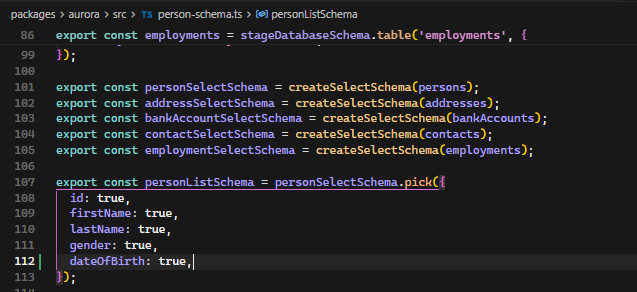
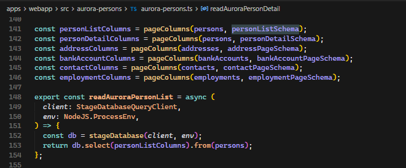
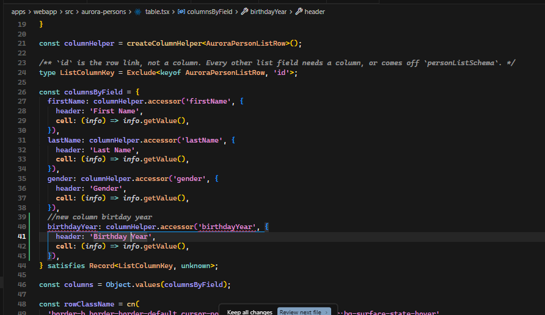
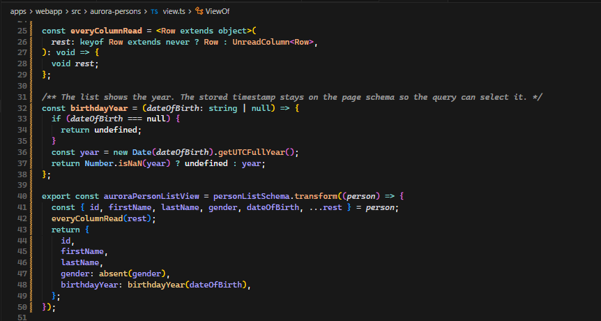
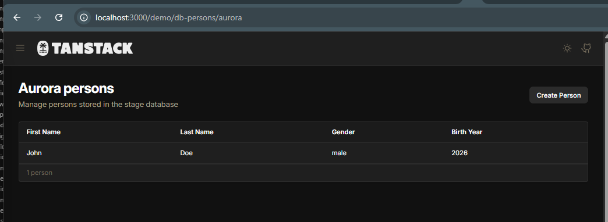
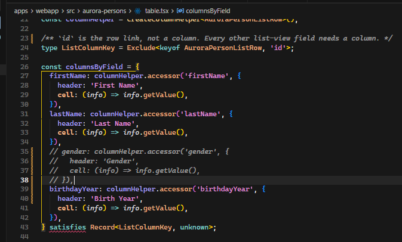
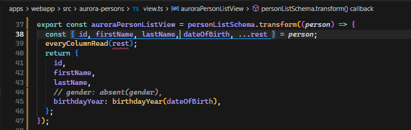
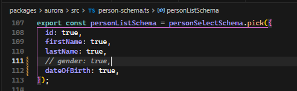
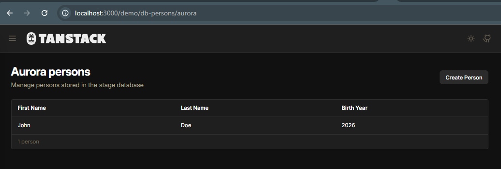

## Introduction

Aurora Data API responses are size-limited, so a Drizzle query should select only the columns a screen uses. In the Aurora persons example, a Zod page schema is that list. [`pageColumns`](https://github.com/JohannesKonings/tanstack-aws/blob/main/apps/webapp/src/aurora-persons/aurora-persons.ts#L129-L139) reads the schema keys and builds the Drizzle selection. [`readAuroraPersonList`](https://github.com/JohannesKonings/tanstack-aws/blob/main/apps/webapp/src/aurora-persons/aurora-persons.ts#L148-L154) selects those columns and nothing else. [`getAuroraPersonList`](https://github.com/JohannesKonings/tanstack-aws/blob/main/apps/webapp/src/aurora-persons/server.ts#L63-L68) then parses each row with the list view, which is the type the table renders.

The running app is the [Aurora persons demo](https://tanstack-aws-examples.com/demo/db-persons/aurora). The source is the [tanstack-aws repository](https://github.com/JohannesKonings/tanstack-aws).

Paging is another way to stay inside the response limit. It is left out here.

## Drizzle schema

[`createSelectSchema(persons)`](https://github.com/JohannesKonings/tanstack-aws/blob/main/packages/aurora/src/person-schema.ts#L101-L105) mirrors the Drizzle table. [`personListSchema`](https://github.com/JohannesKonings/tanstack-aws/blob/main/packages/aurora/src/person-schema.ts#L107-L112) picks the columns the list is allowed to read: `id`, `firstName`, `lastName`, and `gender`. `dateOfBirth` already exists on the [persons table](https://github.com/JohannesKonings/tanstack-aws/blob/main/packages/aurora/src/person-schema.ts#L38-L46) and on [`personDetailSchema`](https://github.com/JohannesKonings/tanstack-aws/blob/main/packages/aurora/src/person-schema.ts#L114-L120). The list does not select it yet.

[`personListColumns`](https://github.com/JohannesKonings/tanstack-aws/blob/main/apps/webapp/src/aurora-persons/aurora-persons.ts#L141-L146) is `pageColumns(persons, personListSchema)`. The list read uses that object as the `select` argument.

## The frontend

The persons screen has a list and a detail view. List columns come from [`AuroraPersonListRow`](https://github.com/JohannesKonings/tanstack-aws/blob/main/apps/webapp/src/aurora-persons/view.ts#L95), the output of [`auroraPersonListView`](https://github.com/JohannesKonings/tanstack-aws/blob/main/apps/webapp/src/aurora-persons/view.ts#L17-L25). In [`table.tsx`](https://github.com/JohannesKonings/tanstack-aws/blob/main/apps/webapp/src/aurora-persons/table.tsx#L23-L40), `id` is the row link, and every other list field needs a column. A key that is not on the row fails at the accessor. A row field with no column fails `satisfies Record<ListColumnKey, unknown>`.

The published view maps each picked column straight through. Nullable values go through `absent`, which turns `null` into `undefined`. `satisfies ViewOf<typeof personListSchema>` rejects a view that drops or invents a key.

### Add a field

The list should show `dateOfBirth`, but only the year. Adding `birthdayYear` to the table fails until the view returns that key.

The stored timestamp has to be on [`personListSchema`](https://github.com/JohannesKonings/tanstack-aws/blob/main/packages/aurora/src/person-schema.ts#L107-L112) first, so [`pageColumns`](https://github.com/JohannesKonings/tanstack-aws/blob/main/apps/webapp/src/aurora-persons/aurora-persons.ts#L129-L139) can select it. The list still does not render the full date.

The published [`auroraPersonListView`](https://github.com/JohannesKonings/tanstack-aws/blob/main/apps/webapp/src/aurora-persons/view.ts#L17-L25) copies each picked field through. Replace that with a transform: `dateOfBirth` becomes `birthdayYear`, and `everyColumnRead` fails the build when a picked column is left unread. The detail view beside it already returns the full timestamp.

The list shows the year. The query still selects only the page-schema columns.

### Remove a column

Removing `gender` follows the same chain. Commenting it out in [`columnsByField`](https://github.com/JohannesKonings/tanstack-aws/blob/main/apps/webapp/src/aurora-persons/table.tsx#L26-L40) is not enough: the row type still includes `gender` until the view stops returning it.

Stop returning it from the [list view](https://github.com/JohannesKonings/tanstack-aws/blob/main/apps/webapp/src/aurora-persons/view.ts#L17-L25). `everyColumnRead(rest)` stays red while `gender: true` is still on the page schema, because `gender` is still in `rest`.

Then take it off the [list pick](https://github.com/JohannesKonings/tanstack-aws/blob/main/packages/aurora/src/person-schema.ts#L107-L112). `rest` is empty, and the select no longer asks Aurora for `gender`. The detail schema can keep it.

The list no longer shows gender, and the query no longer selects it.

## Conclusion

The page schema is the contract. The table must cover every view field, the view must read every schema field, and the Drizzle select is derived from that schema. Adding or removing a list field fails the build until [`person-schema.ts`](https://github.com/JohannesKonings/tanstack-aws/blob/main/packages/aurora/src/person-schema.ts), [`view.ts`](https://github.com/JohannesKonings/tanstack-aws/blob/main/apps/webapp/src/aurora-persons/view.ts), and [`table.tsx`](https://github.com/JohannesKonings/tanstack-aws/blob/main/apps/webapp/src/aurora-persons/table.tsx) stay in sync, which keeps the Aurora query limited to the columns the screen needs.

## Sources and References

- [Aurora persons demo](https://tanstack-aws-examples.com/demo/db-persons/aurora)
- [tanstack-aws](https://github.com/JohannesKonings/tanstack-aws)
- [`personListSchema`](https://github.com/JohannesKonings/tanstack-aws/blob/main/packages/aurora/src/person-schema.ts#L107-L112)
- [`pageColumns` and `readAuroraPersonList`](https://github.com/JohannesKonings/tanstack-aws/blob/main/apps/webapp/src/aurora-persons/aurora-persons.ts#L129-L154)
- [`auroraPersonListView`](https://github.com/JohannesKonings/tanstack-aws/blob/main/apps/webapp/src/aurora-persons/view.ts#L17-L25)
- [`columnsByField`](https://github.com/JohannesKonings/tanstack-aws/blob/main/apps/webapp/src/aurora-persons/table.tsx#L23-L40)
- [`getAuroraPersonList`](https://github.com/JohannesKonings/tanstack-aws/blob/main/apps/webapp/src/aurora-persons/server.ts#L63-L68)
