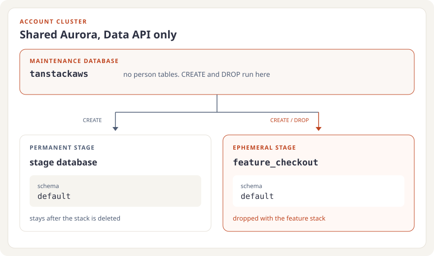
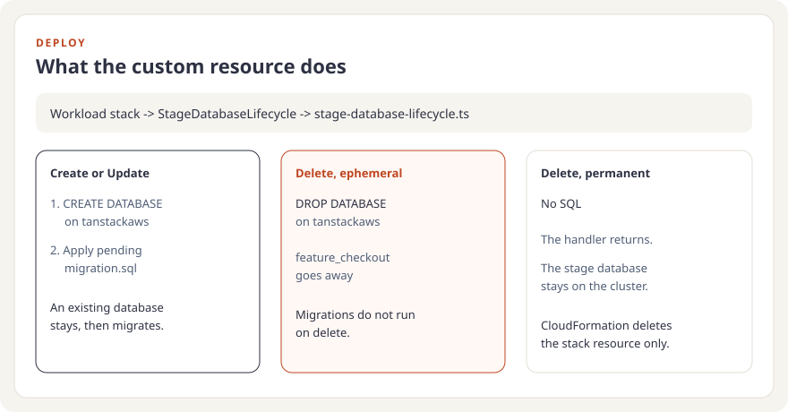
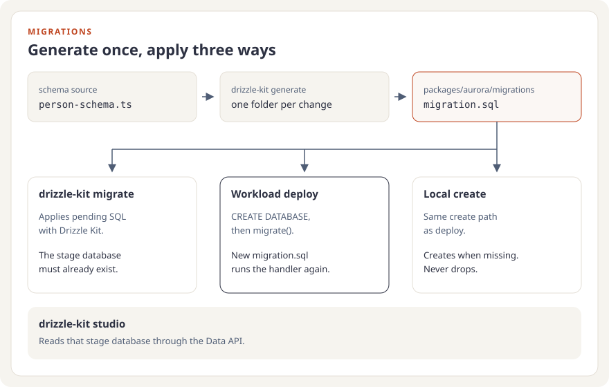
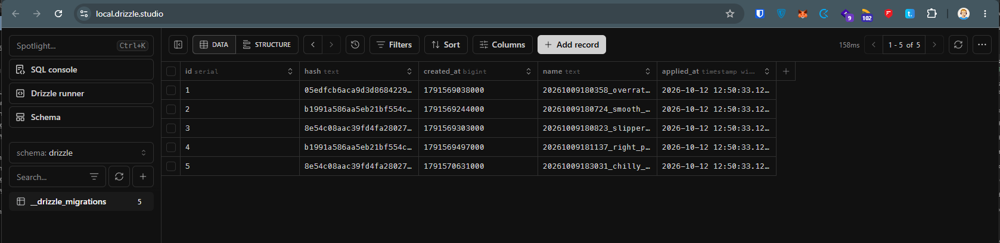
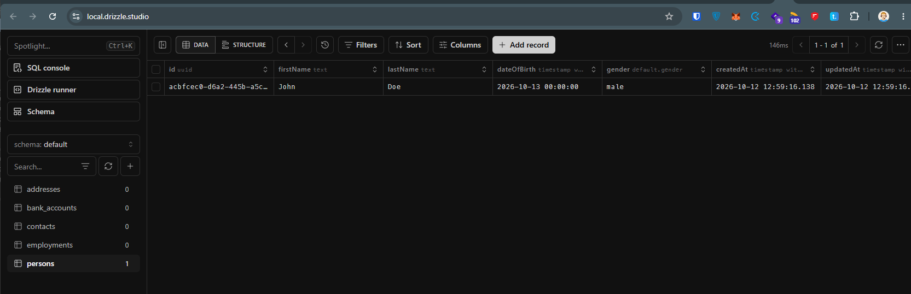

## Introduction

Aurora sits at account level. Every workload stage shares that one cluster: long-lived stages and short-lived feature deployments. The cluster is Data API only, so a workload stack cannot open a connection and create a database itself. Each stage still needs its own PostgreSQL database. A permanent stage keeps that database when the stack is deleted. A feature stage drops it with the stack.

In [tanstack-aws](https://github.com/JohannesKonings/tanstack-aws), account setup owns the cluster and publishes the cluster ARN, secret ARN, and maintenance database name in SSM. Each workload stage then gets a **stage database** on that cluster. A branch named `feature/checkout` becomes stage `feature-checkout` and database `feature_checkout`. Person tables live in schema `default` inside it. The screen that reads those tables is the [Aurora persons demo](https://tanstack-aws-examples.com/demo/db-persons/aurora).

## Where the database lives

The maintenance database is `tanstackaws`. It holds no person tables. `CREATE DATABASE` and `DROP DATABASE` run there, each as its own auto-commit Data API call. SSM parameter `/tanstack-aws/shared/aurora/database-name` stores the name. Account setup writes it when it creates the cluster with `DatabaseName: tanstackaws` and the HTTP endpoint enabled.

[`resolveStageDatabaseName`](https://github.com/JohannesKonings/tanstack-aws/blob/main/packages/aurora/src/stage-database-name.ts#L9-L19) turns the stage into the database name. Hyphens become underscores, so stage `feature-checkout` is database `feature_checkout`. [`STAGE_DATABASE_SCHEMA`](https://github.com/JohannesKonings/tanstack-aws/blob/main/packages/aurora/src/stage-database-name.ts#L2) is `default` in every stage database. The stage name and the schema name stay different identifiers.

A schema per stage inside `tanstackaws` would put every feature stack in the same database as the permanent stages, and the schema name would follow the stage. A database per stage keeps schema `default` stable.

## What a deploy does

[`SharedWorkloadData`](https://github.com/JohannesKonings/tanstack-aws/blob/main/apps/cdk-app/lib/constructs/SharedWorkloadData.ts#L57-L80) reads the three SSM parameters, names the stage database from `appStage`, and registers [`StageDatabaseLifecycle`](https://github.com/JohannesKonings/tanstack-aws/blob/main/apps/cdk-app/lib/constructs/StageDatabaseLifecycle.ts). `dropDatabaseOnDelete` is true only when [`resolveStageLifecycle`](https://github.com/JohannesKonings/tanstack-aws/blob/main/lib/stage-name.ts#L23-L27) returns `ephemeral`. A permanent stage leaves its database in place.

In tanstack-aws, a feature pull request deploys with lifecycle `ephemeral`. Branch `feature/checkout` deploys `TanstackAwsStack-feature-checkout`. Merging the pull request destroys that stack, and the Delete drops `feature_checkout`.

The custom resource handler is [`stage-database-lifecycle.ts`](https://github.com/JohannesKonings/tanstack-aws/blob/main/src/lambda/stage-database-lifecycle.ts#L62-L102). Bundling copies `packages/aurora/migrations` into the Lambda. The handler calls [`applyStageDatabaseLifecycle`](https://github.com/JohannesKonings/tanstack-aws/blob/main/packages/aurora/src/stage-database-lifecycle.ts#L52-L83).

| Custom resource event   | What the lifecycle does                                                                                                                             |
| ----------------------- | --------------------------------------------------------------------------------------------------------------------------------------------------- |
| Create or Update        | `CREATE DATABASE` on `tanstackaws`, then apply pending migrations to the stage database. "Already exists" is ignored, and the migration still runs. |
| Delete, ephemeral stage | `DROP DATABASE IF EXISTS` for that stage database. For `feature/checkout` that is `feature_checkout`. Migrations do not run.                        |
| Delete, permanent stage | Return without SQL. The stage database stays.                                                                                                       |

[`migrationsHash`](https://github.com/JohannesKonings/tanstack-aws/blob/main/apps/cdk-app/lib/constructs/stage-database-migrations-hash.ts#L6-L19) is a SHA-256 of every `migration.sql` in that folder, passed as a custom resource property. A new or edited migration changes the hash, so the next deploy invokes the handler again. A snapshot-only edit does not.

Aurora Serverless can answer `resuming after being auto-paused`. [`withAuroraResumeRetry`](https://github.com/JohannesKonings/tanstack-aws/blob/main/packages/aurora/src/aurora-resume.ts#L36-L58) retries that error four times, 30 seconds apart. Any other error fails immediately. The local create-and-migrate command uses the same helper.

## How the SQL gets there

[`person-schema.ts`](https://github.com/JohannesKonings/tanstack-aws/blob/main/packages/aurora/src/person-schema.ts) is the schema source. `vp run drizzle-kit:generate` writes one folder per migration under `packages/aurora/migrations`, each with `migration.sql` and `snapshot.json`. There is no `meta/_journal.json`. The first migration creates schema `default` and the person tables inside it.

These commands read the deployed workload stack through [`resolveWorkloadStack`](https://github.com/JohannesKonings/tanstack-aws/blob/main/packages/cdk-vite-plugin/src/workload-stack.ts#L34-L50). `APP_STAGE` selects a stack other than the current git branch. Branch `feature/checkout` selects `TanstackAwsStack-feature-checkout` and database `feature_checkout`.

| Task               | Command                                                         | Effect                                                                                                          |
| ------------------ | --------------------------------------------------------------- | --------------------------------------------------------------------------------------------------------------- |
| Generate           | `vp run drizzle-kit:generate`                                   | Write a migration folder from the person schema.                                                                |
| Migrate            | `vp run drizzle-kit:migrate`                                    | Apply pending SQL with Drizzle Kit. The stage database must already exist.                                      |
| Create and migrate | `vp exec tsx packages/aurora/src/cli/migrate-stage-database.ts` | Create the stage database when it is missing, then apply migrations. It never drops a database.                 |
| Studio             | `vp run drizzle-kit:studio`                                     | Open Drizzle Studio against the stage database.                                                                 |
| Seed               | `vp run db-aurora:seed`                                         | Insert 100 persons with addresses, contacts, bank accounts, and employments. Existing rows with those ids stay. |

[`drizzle.config.ts`](https://github.com/JohannesKonings/tanstack-aws/blob/main/packages/aurora/drizzle.config.ts#L15-L25) sets `driver: 'aws-data-api'`. The [Drizzle Kit CLI](https://github.com/JohannesKonings/tanstack-aws/blob/main/packages/aurora/src/cli/drizzle-kit.ts#L26-L36) fills `AURORA_CLUSTER_ARN`, `AURORA_DATABASE_NAME`, `AURORA_SECRET_ARN`, and `AWS_REGION` from the stack outputs before Kit starts. `AURORA_DATABASE_NAME` is the stage database, so Kit migrates and Studio inspects that database.

Deploy uses a different entry to the same SQL. After `CREATE DATABASE`, [`migrateStageDatabaseSchema`](https://github.com/JohannesKonings/tanstack-aws/blob/main/packages/aurora/src/stage-database-drizzle-migrate.ts#L13-L23) calls Drizzle's RDS Data API `migrate()` with the folder bundled into the Lambda. [`migrate-stage-database.ts`](https://github.com/JohannesKonings/tanstack-aws/blob/main/packages/aurora/src/cli/migrate-stage-database.ts#L36-L73) follows that Create path locally: it reads the maintenance database name from SSM, creates the stage database when it is missing, and calls the same migrator. The request type is Create and `dropDatabaseOnDelete` is false, so the command cannot drop a database.

## Checking the data

`vp run drizzle-kit:studio` opens Drizzle Studio on the stage database through the Data API. On branch `feature/checkout` that database is `feature_checkout`. Set `APP_STAGE` to inspect a different deployed stage. The workload stack has to be deployed already, because Studio reads its Aurora outputs.

Applied migrations show up in schema `drizzle`, in `__drizzle_migrations`. Each row is one `migration.sql` the migrator has run.

Person tables live in schema `default`. `persons` is the table the screen reads. Addresses, contacts, bank accounts, and employments sit beside it.

Seed inserts a fixed set of persons and related rows with `onConflictDoNothing`, so running it again leaves existing ids in place. Studio is where those rows show up after the seed, or after a deploy has applied a new `migration.sql`.

## Conclusion

The account owns one Aurora cluster. Each stage owns a database on it. Deploy creates that database from `tanstackaws`, applies the Drizzle SQL, and drops the database only when the stage is ephemeral. The same SQL is what you generate locally, apply with Drizzle Kit once the database exists, or apply with the deploy migrator after creating it. Studio reads the result through the Data API.

## Sources and References

- [tanstack-aws](https://github.com/JohannesKonings/tanstack-aws)
- [Aurora persons demo](https://tanstack-aws-examples.com/demo/db-persons/aurora)
- [`applyStageDatabaseLifecycle`](https://github.com/JohannesKonings/tanstack-aws/blob/main/packages/aurora/src/stage-database-lifecycle.ts#L52-L83)
- [`StageDatabaseLifecycle`](https://github.com/JohannesKonings/tanstack-aws/blob/main/apps/cdk-app/lib/constructs/StageDatabaseLifecycle.ts)
- [`migrateStageDatabaseSchema`](https://github.com/JohannesKonings/tanstack-aws/blob/main/packages/aurora/src/stage-database-drizzle-migrate.ts#L13-L23)
- [Stage database names](https://github.com/JohannesKonings/tanstack-aws/blob/main/packages/aurora/src/stage-database-name.ts)
